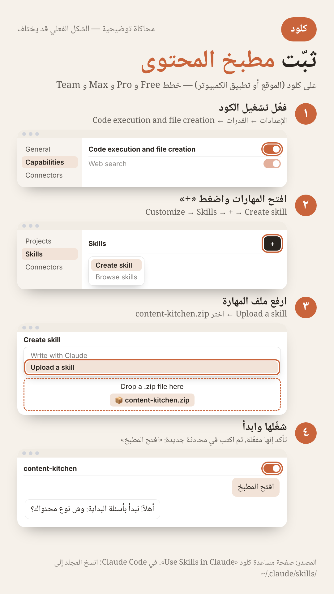
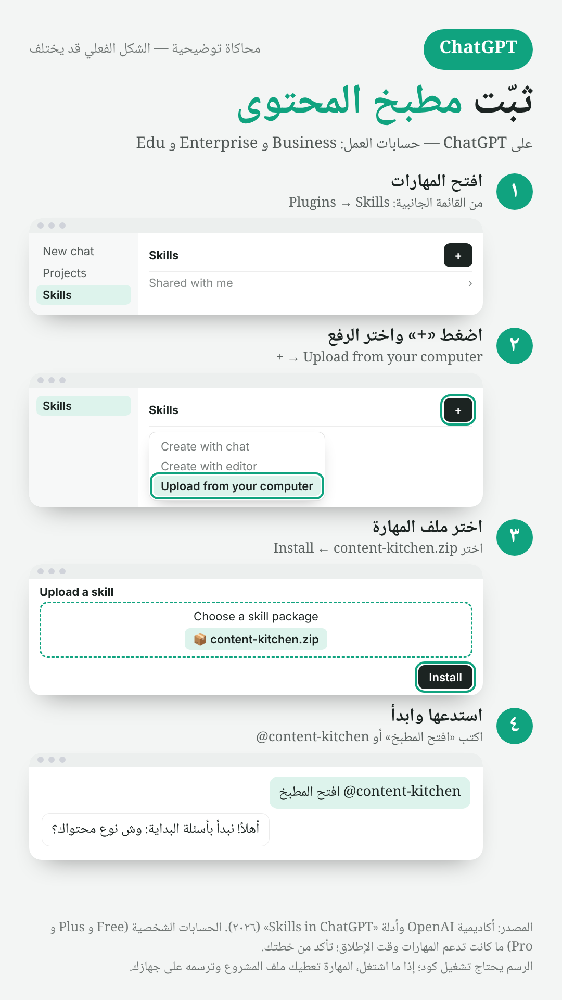
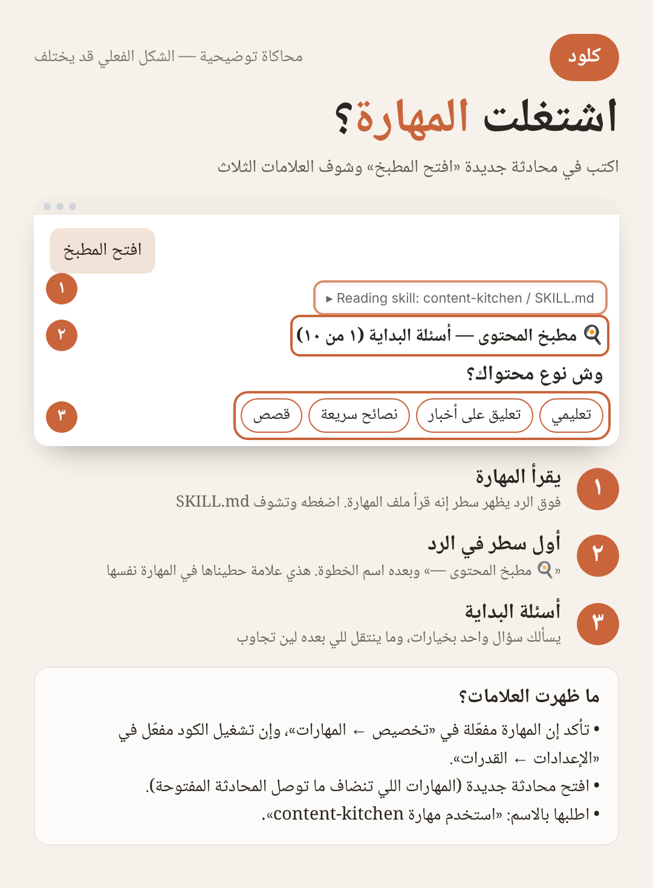
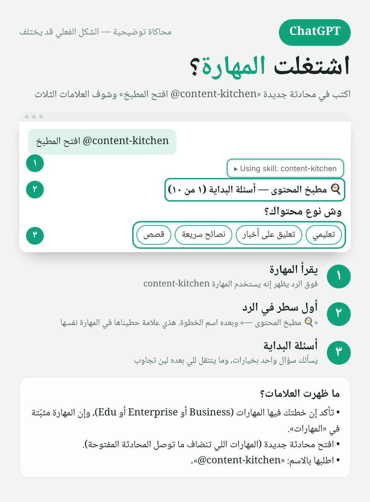

# 🍳 مطبخ المحتوى

بواسطة **يحيى الدريبي** · [@ALDoraibi](https://x.com/ALDoraibi)

**مهارة مجانية تحوّل فكرتك إلى فيديو قصير عمودي، خطوة بخطوة:** الفكرة ← السكربت ← الصوت ← المسودة ← النهائي ← الغلاف. كل خطوة تنتظر موافقتك قبل اللي بعدها، والمهارة تتعلّم من تعديلاتك وتقترح قواعد ما تنطبق إلا لما تعتمدها.

## ⬇️ التحميل

**[حمّل content-kitchen.zip](https://github.com/aldoraibi/content-kitchen/raw/main/content-kitchen.zip)** — ملف واحد ترفعه زي ما هو، لا تفك الضغط.

## التثبيت

### كلود (الموقع أو تطبيق الكمبيوتر)

1. «الإعدادات» ← «القدرات»: فعّل تشغيل الكود وإنشاء الملفات.
2. «تخصيص» ← «المهارات» ← «+» ← «إنشاء مهارة» ← «رفع مهارة».
3. اختر content-kitchen.zip.
4. تأكد إنها مفعّلة، وافتح محادثة جديدة واكتب: **افتح المطبخ**

### ChatGPT (حسابات Business و Enterprise و Edu)

1. افتح «المهارات».
2. «+» ← «رفع من جهازك».
3. اختر content-kitchen.zip ثم «تثبيت».
4. اكتب: **@content-kitchen افتح المطبخ**

### Claude Code

انسخ مجلد content-kitchen إلى ~/.claude/skills/

## كيف تعرف إنها اشتغلت؟

أول سطر في كل رد يبدأ بـ **«🍳 مطبخ المحتوى —»** وبعده اسم الخطوة، وأول شي يسألك «وش نوع محتواك؟» بخيارات. إذا ما ظهر: افتح محادثة جديدة، أو اطلبها بالاسم.

 

*الصور محاكاة توضيحية، والشكل الفعلي قد يختلف.*

## الخطوات

| الخطوة | وش يصير |
|---|---|
| ٠ أسئلة البداية | ١٠ أسئلة وحدة وحدة: نوع محتواك، مجالك، لهجتك، الطول، الألوان، الصور، الصوت، المقاس، ممنوعاتك، اسمك |
| ١ ينتظرك | وش يحتاج قرارك، والقواعد اللي تنتظر اعتمادك |
| ٢ الفكرة | أفكار منتشرة بمصادرها، وما يكرر موضوع سبق |
| ٣ السكربت | بلهجتك وأسلوبك، تعدّله وتعتمده |
| ٤ الصوت | تسجيلك (ينظّفه ويشيل الإعادات) أو صوت مستنسخ، وتسمعه قبل أي فيديو |
| ٥ المسودة | مشاهد متحركة وكابشن تتلوّن فيه الكلمة لحظة نطقها |
| ٦ النهائي | ملاحظاتك (حتى بالثانية: [٠:١٢]) ثم النسخة الكاملة |
| ٧ الغلاف | عنوان وصورة، ويقدر يركّب صورتك على خلفية تناسب الموضوع |

## اللي يحتاجه الرسم

- Node.js و Playwright (`npm i playwright && npx playwright install chromium`) و ffmpeg.
- تسجيلك: `pip install faster-whisper`. الصوت المستنسخ: حساب ElevenLabs والمفتاح في متغيّر البيئة `ELEVENLABS_API_KEY` (لا تكتبه في المحادثة).
- إذا المنصة ما تقدر تشغّل متصفح أو ffmpeg، المهارة تسلّمك مجلد المشروع وترسمه على جهازك.

## الترخيص

الكود والتعليمات: MIT. الخط Noto Naskh Arabic: SIL Open Font License 1.1.

---

# 🍳 Content Kitchen

By **Yahya Aldoraibi** · [@ALDoraibi](https://x.com/ALDoraibi)

A free skill that turns your idea into a short vertical video, step by step: idea → script → voice → draft → final → cover. Every step waits for your approval, and it learns from your edits by proposing rules that apply only after you approve them.

**[Download content-kitchen.zip](https://github.com/aldoraibi/content-kitchen/raw/main/content-kitchen.zip)**

- **Claude:** Settings → Capabilities (turn on code execution) → Customize → Skills → + → Create skill → Upload a skill. Then in a new chat: "open the kitchen".
- **ChatGPT (Business, Enterprise, Edu):** Skills → + → Upload from your computer → Install. Then: "@content-kitchen open the kitchen".
- **Claude Code:** copy the `content-kitchen` folder to `~/.claude/skills/`.

**Is it running?** Every reply starts with `🍳 Content Kitchen — <step>` and the first thing it asks is what kind of content you make.

License: MIT (code), SIL OFL 1.1 (font).
